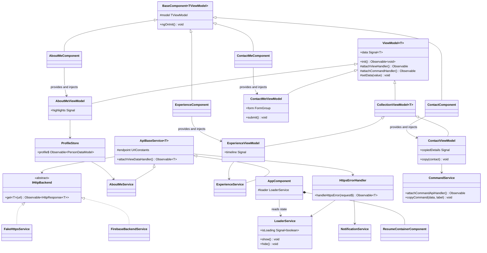
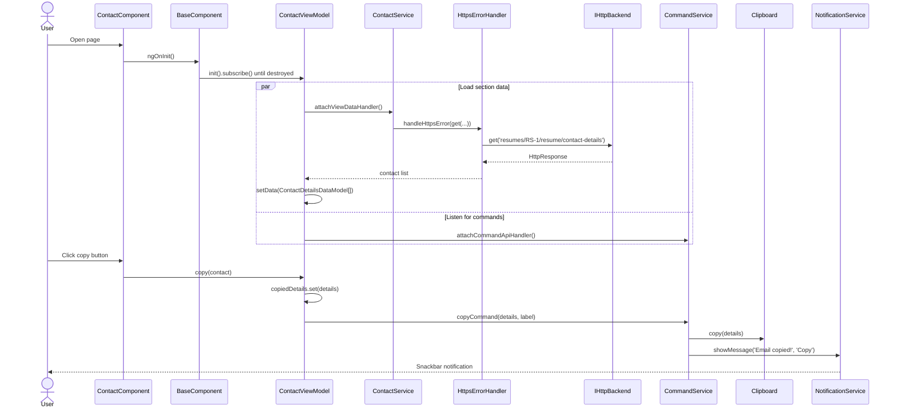

# RaviResume3

## Project Description
This project is the personal portfolio and resume site for Ravi Akhouri, built with Angular 22 and published at
[raviakhouri.in](https://raviakhouri.in). Content is stored in Firebase Firestore and rendered by a zoneless,
signal-based Angular application that follows MVVM, OOP and SOLID principles.

## Development and Security Checks

Install dependencies and run the production build with:

```bash
npm ci
npm run build
```

Run the unit tests once in headless Chrome (this is what CI runs):

```bash
npm run test:ci
```

Check dependencies for known vulnerabilities with:

```bash
npm audit
```

The expected result is zero reported vulnerabilities. `package.json` keeps a single override,
`@grpc/grpc-js`, because the Firebase SDKs pin an older, vulnerable range of it. Avoid pinning other
transitive versions: a pinned override does not receive later security fixes (a stale `fast-uri`
override was the cause of several reported vulnerabilities).

The CI workflow (`.github/workflows/`) runs `npm audit --omit=dev --audit-level=high` and the unit tests
before building and deploying.

## Architecture

### Overview

- **Standalone components**, bootstrapped with `bootstrapApplication` (`src/main.ts`, `src/app/app.config.ts`).
- **Zoneless change detection** with `OnPush` components; view state is exposed as signals, so views update
  exactly when their data changes.
- **MVVM**: every resume section is a thin component bound to a component-scoped view model that owns its
  state, derived values (`computed`) and commands.
- **Single page, no router**: navigation uses in-page anchors. The contact form is loaded with
  `@defer (on viewport)`, which keeps Angular Forms and the Material form field out of the initial bundle.

### Backend abstraction

The application separates feature logic from persistence details through the read-only contract in
`src/app/shared-module/interfaces/i-http-backend.ts`.

- `ApiBaseService<T>` is a Template Method base class: a feature service only declares its `endpoint` and
  payload type, and inherits fetching, loading state and error handling.
- `provideHttpBackend()` binds `IHttpBackend` to an adapter chosen by `environment.backend`
  (`'fake' | 'firebase'`). Adding a backend means adding one entry to its registry.
- `FakeHttpsService` serves `src/app/shared-module/fake-db/fake-db.json` (placeholder data) for local development.
- `FirebaseBackendService` reads Firestore documents with the **Firestore Lite** SDK (one-off reads, much
  smaller than the full SDK) and maps results and failures to `HttpResponse`. Adapters never throw
  synchronously, so they are interchangeable.
- `HttpsErrorHandler` wraps every request: it shows the loader on subscribe, applies a per-request timeout,
  reports non-2xx responses and errors through `NotificationService`, and always releases the loader in
  `finalize`. `LoaderService` counts in-flight requests, so concurrent requests are handled correctly.
- `ProfileStore` fetches the profile (`about-me`) document once and shares it with the introduction,
  about, awards and social-link view models.

### Resume data path

The application uses the following Firestore hierarchy so each user's resume data is isolated:

```text
resumes/{userId}/resume/{section}
```

For example:

```text
resumes/RS-1/resume/about-me
resumes/RS-1/resume/education
resumes/RS-1/resume/experience
```

The feature services request only a section name. `baseUrl` supplies the shared `resumes/{userId}/resume`
prefix, and `FirebaseBackendService` validates and resolves the complete document path. Sections that are
arrays are stored in Firestore as `{ items: [...] }` because a Firestore document must be an object; the
adapter unwraps `items` before returning the response to the application.

The local data source mirrors the same hierarchy in `src/app/shared-module/fake-db/fake-db.json`, so
switching backends does not change the payload shape consumed by the view models.

### Firestore rules

The security rules are versioned in [`firestore.rules`](firestore.rules): anyone may `get` an individual
resume section document; listing collections and **all writes from browsers are denied**. Content is managed
with the Admin SDK, which bypasses the rules.

### Updating resume content

`scripts/import-resume.cjs` is a local administrative utility (ignored by Git, as are the data files and
backups next to it). It writes a JSON file of sections to Firestore and can release the rules at the same time.
Before writing it backs up the current documents and rules to `scripts/backups/<timestamp>/`.

```bash
# Preview what would be written
node scripts/import-resume.cjs <service-account.json> scripts/resume-RS-1.json --dry-run

# Write the sections (and optionally release firestore.rules)
node scripts/import-resume.cjs <service-account.json> scripts/resume-RS-1.json --user RS-1 --rules firestore.rules
```

Keep service-account JSON files outside the repository and never commit them.

### Runtime configuration

The browser Firebase API key is supplied at deployment time rather than stored in Git. For the Azure
deployment, add a GitHub Actions repository secret named `FIREBASE_API_KEY`; the workflow writes the ignored
`src/assets/firebase-config.js` before the production build. Restrict the key in Google Cloud by HTTP referrer
(`raviakhouri.in`) and API scope (Cloud Firestore API). For a local production build:

```bash
cp src/assets/firebase-config.js.example src/assets/firebase-config.js
# Edit firebase-config.js and replace the placeholder with the restricted key.
npm run build -- --configuration production
```

Local development uses the fake backend by default, so `npm start` does not need this file.

### Media (Cloudinary)

The profile photo and resume PDF are served from Cloudinary under fixed public IDs (`environment.media`).
The photo is delivered with `f_auto,q_auto` (AVIF/WebP per browser), cropped around the face, at 1x/2x
sizes; the resume uses `fl_attachment` so it downloads as `Ravi_Akhouri_Resume.pdf`. While
`media.cloudName` is empty the bundled files in `src/assets` are used instead
(`src/app/shared-module/helper-functions/media.ts`).

Upload or replace the files (re-uploading overwrites the same IDs and invalidates the CDN, so URLs never change):

```bash
export CLOUDINARY_URL=cloudinary://<api_key>:<api_secret>@<cloud_name>   # Dashboard → API Keys
npm run upload:media -- --photo scripts/media/profile.png --resume scripts/media/Ravi_Akhouri_Resume.pdf
```

Then set `media.cloudName` in both environment files. Cloudinary blocks PDF delivery on new accounts until
**Settings → Security → "Allow delivery of PDF and ZIP files"** is enabled. `scripts/media/` is ignored by Git.

### Hosting, security headers and SEO

`src/staticwebapp.config.json` configures Azure Static Web Apps: a Content-Security-Policy, HSTS,
`X-Frame-Options`, `Referrer-Policy`, `Permissions-Policy`, long-lived caching for hashed bundles, and a
redirect of unknown paths to `/`. `src/robots.txt` and `src/sitemap.xml` are copied to the site root.
`src/index.html` contains the title, description, canonical URL, Open Graph/Twitter metadata and
`schema.org/Person` structured data. Update these when the job title or experience changes.

### View-model lifecycle

Resume components extend `BaseComponent<TViewModel>` and declare their view model with
`protected readonly model = inject(SomeViewModel)`, listing it in the component `providers` so its state is
scoped to the view. `BaseComponent.ngOnInit` subscribes to `model.init()`, and `takeUntilDestroyed` stops it
when the view is destroyed.

View models extend `ViewModel<T>` (or `CollectionViewModel<T>` for lists). They expose state through the
read-only `data` signal, update it with `setData`, and override the `attachViewHandler` /
`attachCommandHandler` methods. Tests should create them with `TestBed.inject(...)` so they run inside an
injection context.

## Shared Presentation Components

### Timeline

The reusable timeline presentation component is located at:

`src/app/shared-module/components/timeline/`

It accepts a required `ITimeline[]` input through `timelineList`:

```html
<app-timeline [timelineList]="model.timeline()"></app-timeline>
```

Each view model maps its own domain model to `ITimeline` (see
`src/app/shared-module/helper-functions/transform-to-timeline.ts`). The timeline renders the date (`meta`)
in its own column and collapses bullets beyond `visibleBullets` (default 4) behind a "Show more" toggle.
It is used for work experience.

### Card grid

`src/app/shared-module/components/card-grid/` renders the same `ITimeline[]` shape as a responsive grid of
cards, used by projects, awards, education and hobbies:

```html
<app-card-grid [items]="model.timeline()" [numbered]="true"></app-card-grid>
<app-card-grid [items]="model.timeline()" icon="bi bi-award" [columns]="3"></app-card-grid>
```

`numbered` adds a 01, 02, … index, `icon` is the fallback icon for items without their own, and `columns`
(2 or 3) sets the column count on wide screens.

### Live preview and personal projects

`src/app/shared-module/components/live-preview/` shows a running site in a browser-style window: the
page is laid out at 1280px in an iframe, scaled to fit, and panned down and back up like a screen
recording. It pauses on hover and from its play/pause button, and stays still under reduced motion.

The personal projects using it are listed in
`src/app/resume/personal-projects/models/personal-projects.ts`. Each preview origin must also be allowed
by `frame-src` in `src/staticwebapp.config.json`. This site previews itself through the same-origin path
`/?preview=1` (allowed by `frame-ancestors 'self'` and `X-Frame-Options: SAMEORIGIN`); inside that frame
the section shows placeholders instead of loading further previews.

### Design tokens

Colours, fonts, radii and spacing are CSS custom properties in `src/styles.css` (`--accent`, `--text`,
`--font-serif`, …), together with shared `.section`, `.section-header`, `.btn` and `.card` styles. Section
numbers (01, 02, …) come from a CSS counter, and `.reveal` elements fade in on scroll where the browser
supports scroll-driven animations and the user has not asked for reduced motion.

## Folder Structure
```
Resume3.0/
├── .github/workflows/             # Azure Static Web Apps workflow (audit, test, build, deploy)
├── code-review/                   # Review notes and implementation plans
├── scripts/                       # Local Firestore import utility (ignored by Git)
├── src/
│   ├── app/
│   │   ├── app.component.*        # Root component and loading overlay
│   │   ├── app.config.ts          # Application providers (zoneless, backend)
│   │   ├── resume/
│   │   │   ├── about-me/                  # Component, view model, service, ProfileStore
│   │   │   ├── awards-and-achievements/   # Component and view model
│   │   │   ├── contact/                   # Contact details component, view model, service
│   │   │   ├── contact-me/                # Deferred contact form, view model, EmailJS service
│   │   │   ├── education/                 # Component, view model, and service
│   │   │   ├── experience/                # Component, view model, and service
│   │   │   ├── hobbies/                   # Component, view model, and service
│   │   │   ├── introduction/              # Component and view model
│   │   │   ├── professional-skills/       # Component, view model, and service
│   │   │   ├── projects-experience/       # Component, view model, and service
│   │   │   ├── personal-projects/         # Side projects with live previews
│   │   │   ├── resume-container/          # Page layout composing all sections
│   │   │   ├── site-header/               # Sticky header, mobile menu, active-section nav
│   │   │   └── social-media/              # Component and view model
│   │   └── shared-module/
│   │       ├── commands/                  # Copy command
│   │       ├── components/                # Base component, timeline, card grid, live preview
│   │       ├── constants/                 # Resume section endpoints
│   │       ├── enums/                     # Command, context and contact types
│   │       ├── fake-db/                   # Local placeholder data source
│   │       ├── helper-functions/          # Timeline mappers
│   │       ├── interfaces/                # Application contracts
│   │       ├── models/                    # Data models and view-model base classes
│   │       ├── providers/                 # provideHttpBackend()
│   │       ├── services/                  # Backends, request handling, loader, notifications, commands
│   │       └── testing/                   # Test helpers (stub backend)
│   ├── assets/                    # Profile image (AVIF + JPEG) and resume PDF
│   ├── environments/              # Development and production settings
│   ├── index.html                 # SEO metadata and structured data
│   ├── robots.txt / sitemap.xml
│   ├── staticwebapp.config.json   # Azure headers, caching and redirects
│   ├── custom-theme.scss
│   ├── main.ts
│   └── styles.css
├── firestore.rules                 # Firestore security rules
├── angular.json                    # Angular CLI configuration
├── karma.conf.js                   # Karma test runner configuration
├── LICENSE                         # GNU GPL v3.0
├── package.json                    # Scripts and dependencies
├── SECURITY.md                     # Security policy
├── tsconfig*.json                  # TypeScript configurations
└── README.md
```

## Class Diagram


## Flow Diagram
```mermaid
flowchart TD
    A[User opens the application] --> B[bootstrapApplication with zoneless change detection]
    B --> C[ResumeContainerComponent renders the page layout]
    C --> D[Each section component provides and injects its view model]
    D --> E[BaseComponent.ngOnInit subscribes to model.init]
    E --> F[View model calls its feature service or ProfileStore]
    F --> G[HttpsErrorHandler shows loader and applies timeout]
    G --> H{environment.backend}
    H -- fake --> I[FakeHttpsService and fake-db.json]
    H -- firebase --> J[FirebaseBackendService and Firestore Lite]
    I --> K[View model sets its data signal]
    J --> K
    K --> L[OnPush template re-renders the section]
    C --> M[Footer scrolls into view]
    M --> N[@defer loads the contact form chunk]
```

## Sequence Diagram


## How to Build the Project
1. Clone the repository:
   ```bash
   git clone <repository-url>
   cd Resume3.0
   ```
2. Install dependencies:
   ```bash
   npm ci
   ```
3. Start the development server:
   ```bash
   npm start
   ```
   Navigate to `http://localhost:4200/` to view the application.
4. Build the project for production:
   ```bash
   npm run build
   ```

## Running Tests
- **Unit tests**: `npm test` (watch mode) or `npm run test:ci` (single headless run).
- The repository does not currently define an end-to-end test script.

## Additional Notes
- The diagrams describe the current view-model and backend flow; update them when the provider or data-path
  contract changes.

### Reference
- Colour palette: https://colorhunt.co/palette/0000001f150c412d15e1dcc9
