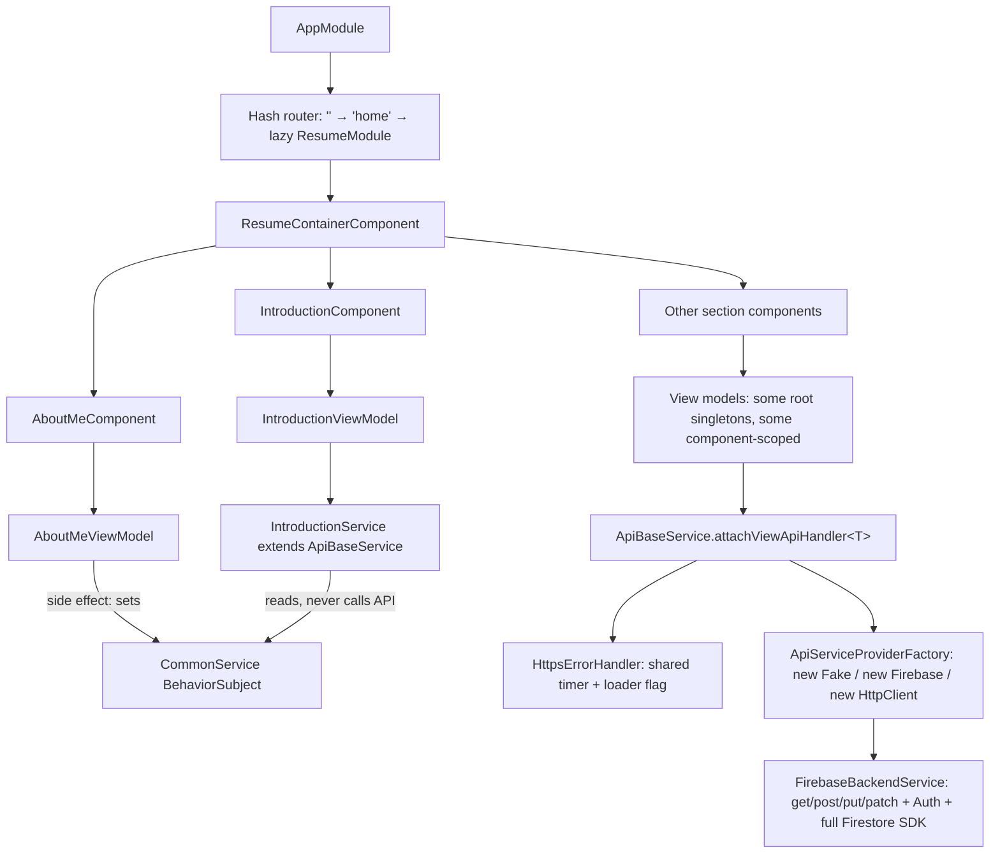
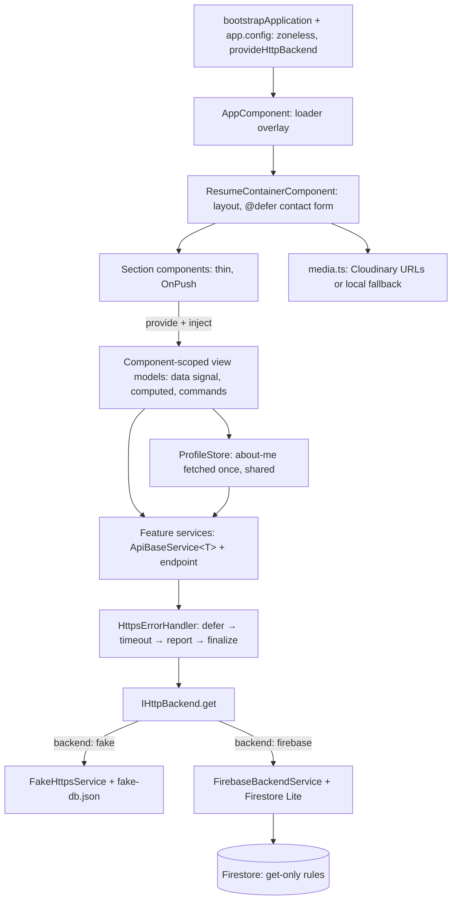

# Architecture Changes – 2026-10-30

This document explains **what changed in the architecture, why, which gaps existed in the previous design,
and how each gap was closed**. The line-by-line list of findings (bugs, vulnerabilities, measurements) is in
[`code-review-2026-10-30.md`](code-review-2026-10-30.md).

## At a glance

| Area | Before | After |
|---|---|---|
| App shell | NgModules (`AppModule`, `ResumeModule`, `SharedModule`), hash router, lazy-loaded feature module for a single page | Standalone components, `bootstrapApplication`, no router, `@defer` for below-the-fold code |
| Change detection | `zone.js`, `ChangeDetectionStrategy.Eager` everywhere, mutable fields | Zoneless, `OnPush` everywhere, state in signals |
| MVVM | Logic split between components and view models; view-model lifetimes inconsistent | Thin components; component-scoped view models own state, derived values, commands and form state |
| Shared data | `CommonService` filled as a side effect of `AboutMeViewModel` | `ProfileStore`: fetch once, share with every consumer |
| Data access | Generic `attachViewDataHandler<T>()`; factory with `new`; read/write/auth interface | `ApiBaseService<T>` (Template Method); DI-selected adapter; read-only `IHttpBackend`; Firestore Lite |
| Request pipeline | Shared mutable timer, loader shown after the response, errors swallowed | Stateless `defer → timeout → catchError → finalize`, counted loader, typed errors |
| Domain models | Getter/setter boilerplate, no defaults | Immutable models that normalise backend data and own small behaviours |
| Configuration | Two booleans for one choice; secrets-adjacent config in components; hard-coded stats | Typed `IEnvironment`; `backend: 'fake' \| 'firebase'`; data-driven content |
| Media | ~35 MB of assets in the bundle, 2.2 MB PNG | Cloudinary (auto format, 1x/2x) with a local AVIF/JPEG fallback |
| Security | Firestore writable by any signed-in user; no CSP; 21 vulnerable packages | Read-only rules in the repo; CSP and security headers; 0 vulnerabilities |
| Quality gates | Test suite did not compile | 40 behaviour tests; CI runs audit + tests before deploying |

## Before

## Gaps and how they were closed

### 1. The application shell did more work than a one-page site needs

**Gap.** The site is one page, but it had a hash router, a lazy-loaded feature module and three NgModules.
The lazy module cost an extra JavaScript round trip before anything rendered. Hash routing turned in-page
links (`#experience`) into router navigations that redirected to `#/home`. `providers: [Location]` referenced
the browser's global `Location` instead of Angular's.

**Change.** Standalone components bootstrapped with `bootstrapApplication` and `app.config.ts`. The router is
removed and navigation uses plain anchors (`scroll-padding-top` keeps targets clear of the sticky header).
The contact form is wrapped in `@defer (on viewport)`.

**Why.** Standalone components are Angular's recommended model and are required for `@defer`. Deferring the
form moves Angular Forms and the Material form field (~119 kB raw) out of the initial bundle. Without a router
there is nothing to misroute, and anchors work the way browsers and crawlers expect.

### 2. Change detection could not tell when state changed

**Gap.** With `zone.js` and the `Eager` strategy, Angular re-checked the whole tree after every event, timer
and promise. That included every mouse move over the many text-magnifier listeners. View models exposed
plain mutable fields, so nothing could mark only the affected view for update.

**Change.** Zoneless change detection, `OnPush` on every component, and view state held in signals
(`ViewModel.data` is a read-only `Signal<T>`; derived values are `computed`).

**Why.** Signals tell Angular exactly which view depends on which value, so a view updates only when its
data changes. This removes `zone.js` from the bundle and makes the cost of change detection proportional to
the actual change.

### 3. MVVM boundaries were blurred

**Gaps.**
- Components contained view logic: getters that re-mapped timeline data on every check, `ContactComponent`
  mutating `isCopied` on model objects, and `ContactMeComponent` building the form and calling EmailJS directly.
- View-model lifetimes were inconsistent: some were root singletons (`@Service()`), others were provided per
  component, so state could outlive the view.
- Overridable hooks were arrow-function properties, which cannot call `super` and do not behave like normal
  methods.
- `BaseComponent` used a getter/setter pair for `model` and required each component to call `inIt()` manually.

**Change.**
- Components only declare `protected readonly model = inject(XViewModel)` and list the view model in their
  `providers`.
- `BaseComponent` starts `model.init()` in `ngOnInit` and stops it automatically with `takeUntilDestroyed`.
- View models own all presentation logic: `timeline` / `highlights` / `links` are `computed`, copy state is a
  signal in `ContactViewModel`, and `ContactMeViewModel` owns the typed form, validation and send workflow.
- `ViewModel<T>` uses real `protected` methods (`attachViewHandler`, `attachCommandHandler`, `setData`);
  `CollectionViewModel<T>` covers list sections.

**Why.** In MVVM the view should be a projection of the view model. With the logic in view models it can be
unit-tested without rendering (see the `*-view-model.spec.ts` files), and component scoping ties state to the
lifetime of the view.

### 4. Shared profile data depended on render order (temporal coupling)

**Gap.** The introduction, awards and social-link sections only received data because `AboutMeViewModel`
happened to load first and push the profile into `CommonService`. `IntroductionService` extended
`ApiBaseService` but never called the API: it inherited a dependency it did not use (an LSP/ISP smell).

**Change.** `ProfileStore` exposes `profile$`, which fetches the `about-me` document once (`shareReplay`) and
replays it to every consumer. `CommonService` and `IntroductionService` are removed.

**Why.** Each consumer now declares its own dependency. Rendering order no longer matters, and the document is
still fetched only once (covered by `profile.store.spec.ts`).

### 5. The data-access layer was not substitutable and was wider than needed

**Gaps.**
- `IHttpBackend` declared `post`, `put`, `patch` and `isAuthenticated` for an app that only reads.
  `FakeHttpsService` threw from them synchronously.
- `ApiServiceProviderFactory` created adapters with `new` and fell back to a raw `HttpClient`, which returns
  bodies, not `HttpResponse`. Adapters were therefore not interchangeable (LSP).
- `attachViewDataHandler<T>()` let every caller choose any `T` for any endpoint, so the types were not
  actually checked.
- The full Firestore SDK and Firebase Auth were shipped to every visitor.

**Change.**
- `IHttpBackend` exposes only `get`, and adapters report failures as `HttpResponse` values instead of throwing.
- `provideHttpBackend()` binds the abstraction through DI from a registry keyed by `environment.backend`.
- `ApiBaseService<T>` is a Template Method base class: a feature service declares only
  `protected readonly endpoint` and fixes `T` at the class level.
- `FirebaseBackendService` uses **Firestore Lite** and Auth is removed.

**Why.** Interface Segregation (the app only reads), Liskov substitution (every adapter honours the same
contract), Open/Closed (a new backend is one registry entry; a new section is a three-line service) and
Dependency Inversion (DI chooses the implementation). Firestore Lite performs one-off REST reads. That suits
a static portfolio, is far smaller, and does not hold a connection open.

### 6. The request pipeline had shared mutable state

**Gap.** `HttpsErrorHandler` kept one `Subscriber` for all requests, so one request could cancel another
request's timer. It showed the loader in `tap`, which runs only after the response arrives. It also converted
non-2xx responses into plain `Error`s that were never shown to the user.

**Change.** A stateless pipeline per request: `defer` (show the loader on subscribe) → `timeout` → unwrap or
throw a typed `HttpStatusError` → report once via `NotificationService` → `finalize` (release the loader).
`LoaderService` counts in-flight requests in a signal.

**Why.** Each request owns its own lifecycle, so concurrent requests cannot interfere, and the loader and
errors are always accurate (covered by `https-error-handler.spec.ts`, including concurrency and timeout).

### 7. The command pattern carried unused and incorrect behaviour

**Gap.** `CommandService` combined clipboard, blob downloads, an unused dialog command and HTTP. Its
`BehaviorSubject`s emitted phantom commands on subscribe, and the copy command removed every space from the
copied text.

**Change.** The command bus is kept, since it decouples the view from side effects, but reduced to the copy
command it actually serves. It uses a plain `Subject` and copies text verbatim. The resume download is now a
normal `<a href download>` link.

**Why.** The pattern was valuable but over-generalised. A plain link is simpler, accessible, crawlable and
needs no JavaScript.

### 8. Domain models were anemic and fragile

**Gap.** About 600 lines of getters and setters gave no real encapsulation, because every field had a public
setter. Missing Firestore fields became `undefined` deep inside templates, and constructors could not be
called without data, which also broke the generated specs.

**Change.** Immutable models with `readonly` fields that normalise missing data to safe defaults and own
small behaviours: `PersonDataModel.yearsOfExperience()` and `ContactDetailsDataModel.href`.

**Why.** Encapsulation means guarding invariants, not wrapping fields. Normalising at the boundary keeps the
rest of the app free of `undefined` checks.

### 9. Content and configuration were hard-coded or loosely typed

**Gap.** "6+ years", "10 projects" and "7 awards" were written into the template. EmailJS IDs lived in a
component. Two booleans (`fakeBackend`, `firebaseBackend`) encoded a single choice and could both be true.

**Change.** A typed `IEnvironment` with `backend: 'fake' | 'firebase'`, plus EmailJS and media settings.
Years of experience are derived from `careerStartDate`; the other figures are `highlights` in Firestore.

**Why.** Content changes should not require code changes, and an impossible configuration should fail to
compile.

### 10. Media was heavy and bundled with the code

**Gap.** Every file in `src/assets` was deployed: about 35 MB, including old PDFs, a 12 MB PNG and a
passport photo. The visible photo was a 2.2 MB PNG.

**Change.** Unused files were removed and the photo became a 27 kB AVIF with a JPEG fallback. The photo and
resume can now be served from **Cloudinary** under fixed public IDs: `f_auto,q_auto`, face-aware crop, 1x/2x
`srcset`, and `fl_attachment` for the PDF. `npm run upload:media` overwrites the same IDs. While
`media.cloudName` is empty, the bundled files are used.

**Why.** A media CDN serves the best format per browser and lets the photo or resume change without a
redeploy. The local fallback means the site never breaks during the switch.

### 11. Security was enforced in the wrong place

**Gap.** The Firestore rules allowed writes for *any* authenticated user, and the rules lived only in the
console. There was no CSP, and 21 vulnerable packages were installed, two of them pinned by stale overrides.
A date of birth sat in a publicly readable document.

**Change.** `firestore.rules` is versioned in the repo and allows only `get` of resume sections; content is
written with the Admin SDK, which takes a backup first. `staticwebapp.config.json` adds a CSP and security
headers. Dependencies are updated with a single justified override, and CI audits them.

**Why.** The browser key is public by design, so the rules are the real security boundary. Keeping them in
the repo makes them reviewable and repeatable.

### 12. There were no quality gates

**Gap.** The generated specs did not compile and only checked "should create". CI built and deployed without
running tests or an audit.

**Change.** Forty behaviour-focused tests run in zoneless TestBed with a synchronous stub backend; CI runs
`npm audit` and the tests before building.

**Why.** Refactoring an architecture is only safe when the behaviour is pinned down by tests.

## After

## Decisions and trade-offs

- **Kept:** the MVVM structure, `BaseComponent`, the command pattern, the timeline and text-magnifier design,
  the loading overlay and the visual design. These were sound ideas whose implementation needed fixing rather
  than replacing.
- **Not done (yet):** server-side prerendering. It would help crawlers that do not run JavaScript but needs a
  Firestore read at build time in CI. Static metadata, JSON-LD and a `<noscript>` summary cover most of the
  SEO value for now.
- **Data stays out of the repo:** `fake-db.json` remains placeholder data. The real content lives in Firestore
  and in the ignored `scripts/resume-*.json` and `scripts/backups/`.
